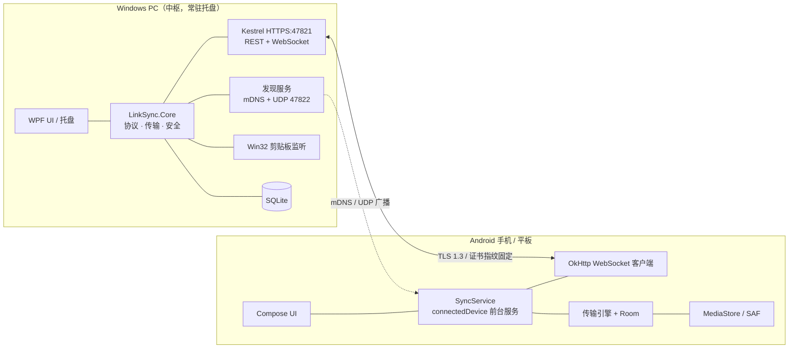
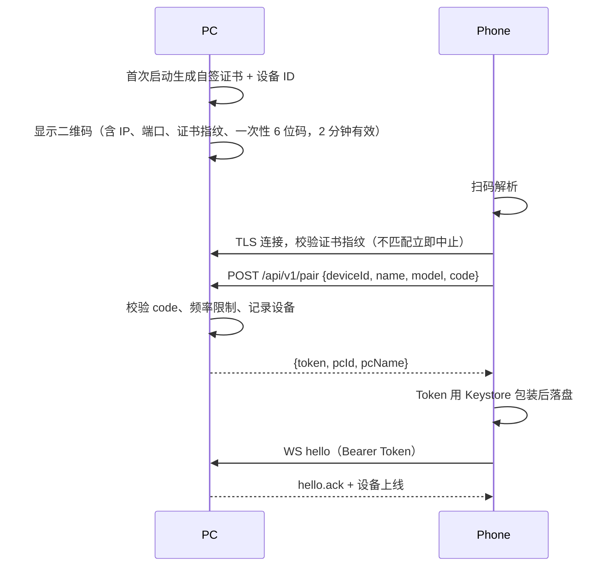
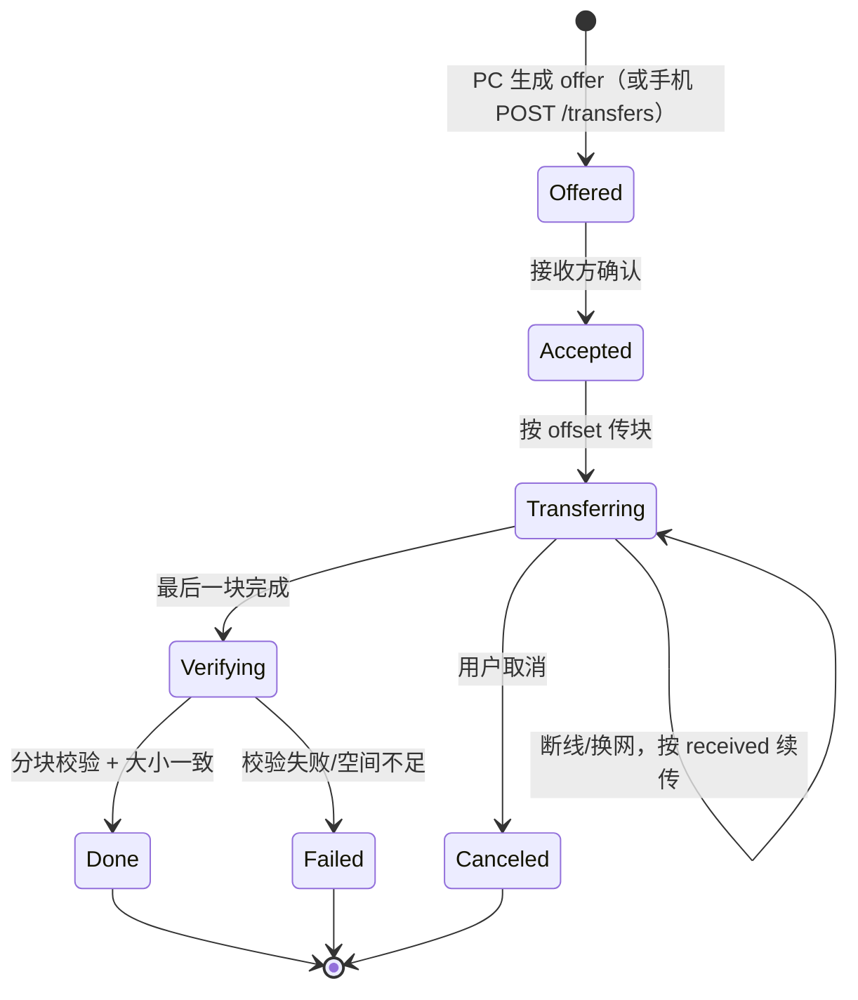

# LinkSync 实现方案（v1 · 待评审）

> ⚠️ **本版已被 `实现方案-v2.md` 取代。** v1 误把 PC 设计为唯一中枢，只能 PC↔Android；实际需求是 PC↔PC、PC↔Android、Android↔Android 任意互传。v1 仅保留作对照。

> 目标：Windows PC ↔ Android 手机/平板 之间完成 **文件互传、剪贴板同步、文本互发并一键复制**，手机端作为前台服务常驻后台，尽量不被厂商省电策略杀死。
>
> 本文只做方案设计，不含代码实现。评审通过后再进入 M0。

- 版本：v1 草案
- 日期：2026-10-31
- 适用：Windows 10/11 x64；Android 10–16（手机 + 平板）
- 暂定名：**LinkSync**（名称、包名 `com.linksync.app` 均可改）

---

## 0. 一页结论

| 项目 | 结论 |
|---|---|
| 产品形态 | PC 端托盘常驻程序（含局域网服务）+ Android 原生 App；**PC 是唯一中枢**，手机/平板作为客户端接入 |
| 网络模型 | 同一局域网内直连，TLS 加密，不经云、不需要账号 |
| PC 技术栈 | **.NET 8 + WPF（WPF-UI 主题）+ Kestrel**，单文件发布，托盘 + 开机自启 |
| Android 技术栈 | **Kotlin + Jetpack Compose + OkHttp + Room + CameraX/ZXing**，最低 Android 10（API 29） |
| 协议 | HTTPS（自签证书 + 二维码带指纹固定）+ WebSocket 长连接 + HTTP Range 分块传输 |
| 剪贴板 PC→手机 | 自动推送；手机自动写入，失败则降级为通知里一键复制 |
| 剪贴板 手机→PC | App 在前台时自动；在后台时由**通知按钮 / 快捷设置磁贴 / 分享菜单 / 选中文本菜单**一键触发 |
| 后台保活 | `connectedDevice` 类型前台服务 + 开机自启 + 电池白名单引导 + 心跳重连 + WorkManager 看门狗；**刻意不用 `dataSync` 类型**以规避 Android 15 的 6 小时限制 |
| 安全 | 二维码配对 + 证书指纹固定 + 每设备独立 Token；只监听私有网段；路径穿越/重放/暴力破解防护 |
| 预计工作量 | 约 14–18 个开发日，分 M0–M6 六个里程碑（详见 §12） |
| 最大风险 | 国产 ROM 后台清理（§14），方案已给出多层缓解，但无法 100% 保证“永不被杀” |

---

## 1. 需求拆解与验收口径

| 编号 | 需求 | 优先级 | 验收标准 |
|---|---|---|---|
| F1 | 设备发现与扫码配对 | P0 | 同一 Wi-Fi 下，手机扫码后 30 秒内完成配对并显示在线；PC 端可查看/吊销设备 |
| F2 | PC → 手机/平板 传文件 | P0 | 拖拽或选择文件后，手机通知确认即开始接收；1 GB 文件 ≥ 25 MB/s；中断后可续传 |
| F3 | 手机/平板 → PC 传文件 | P0 | 系统分享面板或 App 内选择文件即可发送；落到 PC 指定收件目录；支持多选 |
| F4 | 剪贴板 PC → 手机 | P0 | PC 复制文本后 1 秒内手机剪贴板更新（在线、App 存活）；支持开关 |
| F5 | 剪贴板 手机 → PC | P0 | App 前台时自动同步；后台时通过通知/磁贴/分享一键回传，≤2 次点击 |
| F6 | 发送文本供对方复制 | P0 | PC 输入文本 → 手机弹出通知，点“复制”即入剪贴板；反向同理；保留历史 |
| F7 | 后台常驻与自恢复 | P0 | 息屏 24 小时仍在线；重启后自动恢复；断网恢复后 5 秒内重连 |
| F8 | 传输进度、历史、取消 | P1 | 两端可见进度/速度/剩余时间；可取消；历史可查、可清理 |
| F9 | 多台 Android 设备 | P1 | ≥2 台设备同时在线，可分别发送；互不串扰 |
| F10 | 敏感内容保护 | P1 | 密码管理器标记为敏感的内容不同步、不入历史 |
| F11 | 文件夹传输 | P2 | v1 不做，v1.5 以流式 ZIP 或清单方式支持 |
| F12 | 图片/富文本剪贴板 | P2 | v2 支持 |

**v1 明确不做**：公网中继/跨网络、iOS/macOS/Linux、云历史、账号体系、手机↔手机直传、多 PC、端到端加密中继、商店上架、自动更新（v1.5）。

---

## 2. 三条硬约束（它们决定了整个设计）

### 2.1 Android 10+ 禁止后台读剪贴板

系统只允许**默认输入法**或**当前拥有输入焦点的应用**读取剪贴板。这意味着：

- PC → 手机：**写入**一般不受限（部分 ROM 后台会拦截，需降级处理），可做全自动。
- 手机 → PC：**读取**受限，App 在后台时无论前台服务多顽强都读不到。
  - 前台自动同步：可行。
  - 后台“全自动”回传：不可行，除非做输入法或无障服务（成本高、隐私敏感、上架受限）。v1 采用**用户一键触发**（通知按钮 / 磁贴 / 分享 / 选中文本菜单），这是 KDE Connect 等成熟产品同样接受的折中。
  - 参考：[Android 剪贴板文档](https://developer.android.com/develop/ui/views/touch-and-input/copy-paste)、[Android 10 行为变更](https://developer.android.com/about/versions/10/privacy/changes#clipboard-data)

> 产品文案必须提前说明这一点，否则用户会认为“剪贴板同步坏了”。

### 2.2 前台服务类型与 Android 15 超时

- Android 14+ 必须声明前台服务类型并申请对应权限。
- Android 15 起，`dataSync` 类型的前台服务**每 24 小时最多运行 6 小时**，超时回调 `Service.onTimeout()`。用它做常驻连接必然翻车。
- `connectedDevice` 类型用于“与外部设备（蓝牙/NFC/USB/网络）交互”，**没有 6 小时限制**，且不在 Android 15 的 `BOOT_COMPLETED` 启动限制名单内。
- 因此：**常驻连接服务只声明 `connectedDevice`**，文件传输也复用同一个服务。参考：[前台服务类型](https://developer.android.com/develop/background-work/services/fgs/service-types)、[前台服务超时](https://developer.android.com/develop/background-work/services/fgs/timeout)

### 2.3 国产 ROM 无 GMS + 激进省电

- 不能用 FCM 推送、不能用 Google ML Kit 扫码（大量国产机无 GMS）。
- 扫码用 ZXing（离线、无 GMS 依赖），相机用 CameraX。
- 保活不能只靠 `startForeground`，必须叠加：电池白名单、厂商自启动引导、心跳重连、看门狗、开机广播。

---

## 3. 技术选型

### 3.1 本机环境现状（已实测）

| 工具 | 状态 | 说明 |
|---|---|---|
| .NET SDK | ✅ 8.0.133（含 WindowsDesktop / ASP.NET Core 8.0.33） | 可直接开发 WPF + Kestrel |
| Node.js | ✅ v20.10.0（无 pnpm） | 仅备用，不用于主方案 |
| adb | ✅ 33.0.0（system32） | 版本偏旧，建议随 SDK 更新 |
| JDK | ❌ 未安装 | 必须补装 Temurin 17 |
| Android SDK / Gradle / Flutter | ❌ 未安装 | 需补装 cmdline-tools + platform 35 + build-tools |
| 磁盘 | ✅ 约 543 GB 可用 | 足够 |

**需要补装（约 2–3 GB）**：Temurin JDK 17、Android cmdline-tools、`platforms;android-35`、`build-tools;35.0.0`、`platform-tools`（可选模拟器镜像）。
国内网络建议：Gradle 发行版与 Maven 走腾讯/阿里云镜像，SDK 组件可手动下载解压。

### 3.2 选型对比

| 方案 | PC 端 | Android 端 | 优点 | 否决原因 |
|---|---|---|---|---|
| **A. 本方案** | .NET 8 + WPF + Kestrel | Kotlin + Compose | Windows 集成最稳、单文件分发、原生后台服务、无 GMS 依赖 | 两种语言，协议需双端实现（用 JSON Schema + 共享测试向量约束） |
| B. 全栈 Web 技术 | Electron + Node | Capacitor + 原生插件 | UI 开发快、代码复用高 | Electron 100 MB+；剪贴板变更需轮询；Android 侧仍要写原生服务，复用没想象中多 |
| C. Kotlin 全家桶 | Compose Desktop | Compose | 单语言、协议与模型共享 | 桌面端托盘/剪贴板监听/防火墙/单实例都要 JNA 手写；JVM 包体大、启动慢 |
| D. Fork LocalSend | Flutter | Flutter | 文件传输现成 | 无剪贴板、后台弱、依赖重；改造成本不低于自研 |
| E. KDE Connect / Syncthing | 现成 | 现成 | 成熟 | 不可定制 UI/流程；KDE Connect 同样受剪贴板限制；Syncthing 无文本/剪贴板 |
| F. PWA | 浏览器 | 浏览器 | 零安装 | 无法后台常驻、无法自动读写剪贴板、无法开机自启 → 直接排除 |

**推荐 A**。若你更看重“单语言、一套模型”，可换 C，但 Windows 端集成工作量会增加约 30%。

### 3.3 关键依赖

| 端 | 库 | 用途 | 许可 |
|---|---|---|---|
| PC | WPF-UI (lepo.co) | Fluent 风格界面 | MIT |
| PC | CommunityToolkit.Mvvm | MVVM | MIT |
| PC | Makaretu.Dns | mDNS 广播/发现 | MIT |
| PC | QRCoder | 生成配对二维码 | MIT |
| PC | Microsoft.Data.Sqlite | 本地库 | MIT |
| PC | Hardcodet.NotifyIcon.Wpf | 托盘图标/菜单 | CPOL（可换 WinForms NotifyIcon） |
| Android | OkHttp | HTTPS / WebSocket / Range 下载 | Apache-2.0 |
| Android | Room | 本地库 | Apache-2.0 |
| Android | CameraX + ZXing core | 扫码 | Apache-2.0 / MIT |
| Android | WorkManager | 看门狗 | Apache-2.0 |
| Android | Compose BOM / Navigation | UI | Apache-2.0 |

---

## 4. 总体架构

### 4.1 拓扑



**为什么 PC 做唯一服务端**：只维护一套证书与鉴权；手机端不必开监听端口（省权限、少攻击面）；PC 天然常电常网。手机只作为 WS 客户端 + HTTP 客户端。手机↔手机不在 v1 范围。

### 4.2 端口与发现

| 用途 | 协议 | 端口 |
|---|---|---|
| REST + WebSocket | TCP/HTTPS | 47821（可配置） |
| UDP 广播发现（兜底） | UDP | 47822 |
| mDNS 服务发现 | UDP 组播 | 5353，服务名 `_linksync._tcp` |

mDNS TXT：`id`、`name`、`ver`、`fp`（证书指纹前 16 位）、`port`。
Android 侧需 `MulticastLock` 才能稳定收到组播；部分企业 Wi-Fi 开启 AP 隔离时两者都失效 → 回退扫码里的 IP 直连。

### 4.3 配对流程



- 二维码是带外信道：指纹与一次性码都在码里，天然防局域网中间人。
- 手工配对（无法扫码时）：手机输入 PC 显示的 IP + 6 位码；因无带外指纹，此时以“首次连接展示指纹前 8 位供人工比对”作为补偿。
- 配对码单次有效、2 分钟过期、每分钟最多 5 次尝试；连续失败 10 次封禁该 IP 5 分钟。

---

## 5. 通信协议

### 5.1 约定

- Base path：`/api/v1`，JSON UTF-8，字段 `snake_case`。
- 版本头：`X-LinkSync-Protocol: 1`；不兼容时返回 `426`。
- 时间戳：Unix 毫秒；ID：UUIDv7 / ULID（可排序）。
- 鉴权：`Authorization: Bearer <token>`；WebSocket 同样走 Header（OkHttp 支持）。
- 仅接受 RFC1918 / 链路本地地址来源，公网地址一律 403（可配置关闭）。

### 5.2 REST 端点

| 方法 | 路径 | 说明 | 鉴权 |
|---|---|---|---|
| GET | `/info` | PC 名称、版本、协议版本、能力位 | 否 |
| POST | `/pair` | 配对换 Token | 配对码 |
| GET | `/devices` | 已配对设备列表 | 是 |
| DELETE | `/devices/{id}` | 吊销设备（断开并删 Token） | 是 |
| POST | `/clipboard` | 手机推送剪贴板/文本 | 是 |
| GET | `/clipboard?limit=50` | 剪贴板历史 | 是 |
| POST | `/messages` | 发送文本消息 | 是 |
| GET | `/messages?limit=50` | 文本历史 | 是 |
| POST | `/transfers` | 创建上传会话（手机→PC） | 是 |
| PUT | `/transfers/{tid}/files/{fid}?offset=N` | 上传分块（`application/octet-stream`） | 是 |
| POST | `/transfers/{tid}/files/{fid}/complete` | 校验并落盘 | 是 |
| GET | `/transfers/{tid}` | 传输状态 | 是 |
| DELETE | `/transfers/{tid}` | 取消并清理临时文件 | 是 |
| GET | `/transfers/{tid}/files/{fid}` | 下载（支持 `Range`，PC→手机） | 是 |
| GET | `/health` | 存活探测 | 否 |

### 5.3 WebSocket 消息

端点 `/api/v1/ws`。统一信封：

```json
{"v":1,"id":"01J9Z6...","type":"clipboard.push","ts":1730000000123,"payload":{}}
```

| 方向 | type | 说明 |
|---|---|---|
| 手机→PC | `hello` | 上线，携带设备信息与能力位 |
| PC→手机 | `hello.ack` | 确认，返回待办（离线消息、待接收文件） |
| 双向 | `ping` / `pong` | 应用层心跳（25 s） |
| PC→手机 | `clipboard.push` | `{content_type:"text/plain", text, hash, origin_id, sensitive}` |
| 手机→PC | `clipboard.push` | 同上（前台自动或用户触发） |
| PC→手机 | `clipboard.ack` | `{hash, applied, mode:"auto"\|"notification"}` |
| PC→手机 | `text.message` | `{text, id, from}` |
| 手机→PC | `text.message` | 同上 |
| PC→手机 | `file.offer` | `{transfer_id, files:[{id,name,size,mtime}], total_bytes}` |
| 手机→PC | `file.accept` / `file.reject` | 接受/拒绝接收 |
| 双向 | `transfer.progress` | `{transfer_id, file_id, received, total, bps}` |
| 双向 | `transfer.done` / `transfer.error` | 完成/失败（含错误码） |
| PC→手机 | `device.revoked` | 被吊销，手机需清除 Token |
| 双向 | `presence` | 在线状态、电量、网络类型（可选） |

**离线补投**：PC 为每个设备维护 pending 队列（文本、剪贴板最新值、文件 offer）。`hello` 后按序重发，手机回 ack 后出队；保留 7 天或 200 条上限。

> 注意：没有 GMS 就没有系统级推送，**PC 无法唤醒已被杀死或离线的手机**。离线期间只排队，等手机重连（打开 App、开机、网络恢复）后补投。PC 端必须把“离线/排队中”显示清楚。

### 5.4 文件传输状态机



- 分块：**1 MiB**，每块带 `X-Chunk-SHA256`；接收端逐块校验，坏块请求重传（最多 3 次）。
- 默认并发：单个文件内串行传块（保证顺序写），文件与文件之间并发 2–3 个；可配置。
- 断点：接收端写 `<name>.linksync-part`，旁挂 `.meta.json`（offset、sha 列表、mtime）；重连后 `GET /transfers/{tid}` 取回 offset。
- 落盘：先写临时文件，完成后 `fsync` + 原子重命名；Android 用 `MediaStore` 的 `IS_PENDING=1`，完成后置 0。
- 文件名安全：去除路径分隔符、`..`、Windows 保留名（CON/PRN/AUX/NUL/COM1…）、结尾空格与点；单段 ≤ 200 字符；重名追加 ` (1)`。
- 大文件：全程流式，内存占用 ≤ 4 MB；偏移用 `long`；实测 8 GB 通过。
- 完整性：默认分块校验 + 字节数；设置里可选“严格模式”（整文件 SHA-256，代价是断点续传场景需重算）。

### 5.5 错误码

`4001` 配对码错误/过期 · `4003` Token 无效 · `4009` 设备已吊销 · `4013` 文件名非法 · `4021` 磁盘空间不足 · `4022` 校验失败 · `4029` 传输不存在 · `4290` 频率限制 · `5001` 内部错误。

---

## 6. 剪贴板与文本同步（含能力边界）

### 6.1 能力矩阵（必须让用户知道）

| 场景 | PC → 手机 | 手机 → PC |
|---|---|---|
| App 在前台、屏幕亮 | ✅ 自动（<1 s） | ✅ 自动（轮询 800 ms + 变更监听） |
| App 在后台、屏幕亮 | ✅ 自动写入；失败则通知 | ❌ 系统禁止读取 → 一键触发 |
| 屏幕熄灭 / 锁屏 | ✅ 写入（部分 ROM 可能拦截，降级通知） | ❌ 一键触发（需解锁） |
| 手机刚重启、服务未起 | ⏳ 排队，连上后投递 | ⏳ 排队 |

“一键触发”的入口（按易用性排序）：

1. **常驻通知按钮**“发送剪贴板到电脑”（无需打开 App，`PendingIntent.getActivity`）。
2. **快捷设置磁贴**（下拉通知栏；Android 14+ 必须用 `startActivityAndCollapse(PendingIntent)`，Intent 重载会被后台启动限制拦截）。
3. **系统分享菜单 / 选中文本菜单**（`ACTION_SEND`、`ACTION_PROCESS_TEXT`）——“发送到电脑”。
4. App 内“发送剪贴板”按钮。
5. 可选：桌面悬浮球（v2）。

> 磁贴与通知按钮都不能直接读剪贴板（无焦点）。实现方式：启动一个**透明、无动画、立即 finish 的 Activity**（`ClipboardBridgeActivity`）取得窗口焦点后读取，再交给前台服务发送。这是目前唯一稳定的免 ROOT 方案。
>
> 两个坑：① Android 12+ 禁止“通知 → 广播 → 再启动 Activity”的 trampoline，所以“发送剪贴板”必须直接使用 `PendingIntent.getActivity`；② Android 14+ 对 TileService 启动 Activity 有额外限制，磁贴走 PendingIntent 重载，失败时 Toast 引导用户改用通知按钮。磁贴属于“锦上添花”，不作为唯一入口。

### 6.2 PC 侧实现

- 隐藏消息窗口 + `AddClipboardFormatListener`，处理 `WM_CLIPBOARDUPDATE`。
- 支持格式：`CF_UNICODETEXT`（v1）；`CF_HDROP`、`CF_DIB`（v2）。
- 读取失败重试 5 次（剪贴板常被 Office/输入法短暂占用）。
- **回环抑制**：记录 `last_applied_hash + 时间戳`，2 秒内相同内容不再回传；所有消息带 `origin_id`，收到自己发出的内容直接忽略。
- **敏感内容**：检测 `ExcludeClipboardContentFromMonitorProcessing` 与 `CanIncludeInClipboardHistory=0` 格式，命中则不同步、不入历史（密码管理器常用）。
- 去抖 150 ms；单条文本上限 100 KB，超出提示改用“发送文件”。
- 变更后仅推给“在线且开启自动同步”的设备。

### 6.3 Android 侧实现

- 写入：`ClipboardManager.setPrimaryClip(ClipData.newPlainText(...))`；Android 13+ 系统会显示“已复制”浮层（含应用名），无法屏蔽，属正常现象，需在引导页说明，避免用户误以为弹广告。
- 读取（前台）：`OnPrimaryClipChangedListener` + 800 ms 轮询双保险；读取前检查 `ClipDescription.extras` 的 `EXTRA_IS_SENSITIVE`（API 33+），敏感则跳过。
- 通知：每个文本消息一条通知，`setAutoCancel(true)`，Action “复制” → `BroadcastReceiver` 直接写剪贴板（用户点击即前台交互，稳定可行）。
- 历史：Room 存最近 200 条，默认 7 天过期；可设“不记录”。
- 大文本/多行：通知折叠展示前 200 字，点开进 App 查看全文。

### 6.4 文本消息 vs 剪贴板同步

两者共用传输通道，但语义分开：

- **剪贴板同步**：静默、自动、幂等，用于“我在 PC 上复制，手机上直接粘贴”。
- **发送文本**：显式动作，带通知与历史，用于“把这段文字发到手机，我要复制”。
- UI 上分成两个入口，避免用户混淆；底层消息类型可复用。

---

## 7. 文件传输设计

### 7.1 路径与落点

| 方向 | 发起 | 落点 |
|---|---|---|
| PC → 手机 | PC 拖拽/选择/右键“发送到设备” | 默认 `Download/LinkSync/`（MediaStore，无需存储权限）；可改为用户选的 SAF 目录 |
| 手机 → PC | 系统分享 / App 内选择（SAF） | 默认 `%USERPROFILE%\Downloads\LinkSync\<设备名>\<yyyy-MM-dd>\`，可配置 |
| 手机 → PC（文本） | 分享文本 | 直接进 PC 剪贴板 + 历史 |

### 7.2 Android 存储细节

- 接收：API 29+ 用 MediaStore Downloads（`RELATIVE_PATH=Download/LinkSync`），先 `IS_PENDING=1` 写完再发布；同名自动加序号。
- 发送：`ACTION_OPEN_DOCUMENT`（多选）或 `ACTION_OPEN_DOCUMENT_TREE`（文件夹，v1.5）；从 `ContentResolver` 流式读，大小取 `OpenableColumns.SIZE`，缺失时按块传输并事后校正。
- 权限：API 29+ 基本无需 `READ/WRITE_EXTERNAL_STORAGE`；SAF 目录用 `takePersistableUriPermission` 持久化。
- 前台服务内传输，通知显示进度条；锁屏可见。

### 7.3 队列与并发

- 手机端维护 outbox（Room）：断网/PC 离线时任务入队，连上后自动重试（指数退避 5 s → 5 min）。
- PC 端维护 pending offer：目标离线时文件不复制、只记路径，连上后再发 offer；源文件被移动/删除则标记失败。
- 限速可选（默认不限）；“仅 Wi-Fi 传输”开关（默认开）。
- 传输期间持有 `PARTIAL_WAKE_LOCK` + `WifiLock(HIGH_PERF)`，结束立即释放；PC 端用 `SetThreadExecutionState` 阻止系统睡眠。

### 7.4 文件夹（v1.5）

两种实现二选一：流式 ZIP（实现快、手机端解压体验差）或 manifest 逐文件（体验好、代码多）。建议 v1.5 用 manifest，保留目录结构。

---

## 8. Android 后台常驻方案（重点）

### 8.1 服务设计

- 单例 `SyncService`：`startForeground(id, notification, FOREGROUND_SERVICE_TYPE_CONNECTED_DEVICE)`。
- 职责：维持 WS、收发剪贴板/文本、调度传输、重连、心跳。
- `START_STICKY` + `stopWithTask=false`；用户“退出”才真正 stop。
- 通知渠道 `sync_status`：`IMPORTANCE_LOW`、静音、`setOngoing(true)`、`CATEGORY_SERVICE`；显示“已连接 DESKTOP-XXX / 正在传输 3 个文件（45%）”。
- 通知 Action：`发送剪贴板`、`暂停同步`、`打开`。
- 传输进度用**同一通知**更新（`setOnlyAlertOnce`），避免通知轰炸。

### 8.2 Manifest 草案

```xml
<uses-permission android:name="android.permission.INTERNET"/>
<uses-permission android:name="android.permission.ACCESS_NETWORK_STATE"/>
<uses-permission android:name="android.permission.ACCESS_WIFI_STATE"/>
<uses-permission android:name="android.permission.CHANGE_WIFI_MULTICAST_STATE"/>
<uses-permission android:name="android.permission.FOREGROUND_SERVICE"/>
<uses-permission android:name="android.permission.FOREGROUND_SERVICE_CONNECTED_DEVICE"/>
<uses-permission android:name="android.permission.POST_NOTIFICATIONS"/>
<uses-permission android:name="android.permission.RECEIVE_BOOT_COMPLETED"/>
<uses-permission android:name="android.permission.WAKE_LOCK"/>
<uses-permission android:name="android.permission.REQUEST_IGNORE_BATTERY_OPTIMIZATIONS"/>
<uses-permission android:name="android.permission.CAMERA"/>

<service
    android:name=".service.SyncService"
    android:exported="false"
    android:foregroundServiceType="connectedDevice"
    android:stopWithTask="false"/>

<receiver android:name=".service.BootReceiver" android:exported="true">
    <intent-filter>
        <action android:name="android.intent.action.BOOT_COMPLETED"/>
        <action android:name="android.intent.action.MY_PACKAGE_REPLACED"/>
    </intent-filter>
</receiver>
```

其他组件：`ClipboardBridgeActivity`（透明、`noHistory`、`excludeFromRecents`）、`ShareActivity`（`ACTION_SEND` text/* 与 */*）、`ProcessTextActivity`（`ACTION_PROCESS_TEXT`）、`SyncTileService`（`BIND_QUICK_SETTINGS_TILE`）。

### 8.3 保活链路（多层，不依赖单点）

1. **前台服务**：最高优先级通知，系统层面最难杀。
2. **心跳**：WS ping 25 s；25 s 无 pong 判定假连接，主动重连。
3. **网络回调**：`ConnectivityManager.NetworkCallback`，Wi-Fi/移动网络切换、恢复时立即重连并重新解析 PC IP（mDNS 缓存会过期）。
4. **重连退避**：1 s、2 s、5 s、10 s、30 s、60 s 上限；成功后退回 1 s。
5. **屏幕亮起**：监听 `ACTION_SCREEN_ON` / `ACTION_USER_PRESENT`，触发一次重连（ROM 常在息屏时冻结网络）。
6. **WorkManager 看门狗**：每 15 分钟检查服务/连接，异常则 `startForegroundService`；注：Doze 下可能延后，属兜底。
7. **开机自启**：`BOOT_COMPLETED` → 启动服务（`connectedDevice` 类型允许）。
8. **任务划掉后**：`onTaskRemoved` 里尝试重启服务；失败则交给看门狗。
9. **PC 侧感知**：设备离线超过 2 分钟，托盘提示“手机连接已断开，可能被系统清理”，并给出排查入口。

### 8.4 省电白名单与厂商引导

首次启动进入“保活向导”（逐项检测、一键跳转）：

| 项目 | 做法 |
|---|---|
| 通知权限（Android 13+） | 运行时申请 `POST_NOTIFICATIONS` |
| 电池优化白名单 | `ACTION_REQUEST_IGNORE_BATTERY_OPTIMIZATIONS`；被拒则给出手动路径 |
| 厂商自启动 | 按 `Build.MANUFACTURER` 跳转对应设置页，失败则展示图文步骤 |
| 后台弹窗/锁屏显示 | 部分 ROM 需允许“后台弹出界面”“锁屏显示” |
| 自启动管理 | MIUI「自启动」、EMUI「应用启动管理→手动管理」、ColorOS「允许后台运行」、OriginOS「后台高耗电」、One UI「电池→不受限制」 |

已知厂商 Intent（需 try/catch，跳转失败回退说明页）：

- 小米：`com.miui.securitycenter/com.miui.permcenter.autostart.AutoStartManagementActivity`
- 华为：`com.huawei.systemmanager/.startupmgr.ui.StartupNormalAppListActivity`
- OPPO：`com.coloros.safecenter/.permission.startup.StartupAppListActivity`
- vivo：`com.vivo.permissionmanager/.activity.BgStartUpManagerActivity`
- 三星：`com.samsung.android.lool/.activity.BatteryActivity`

### 8.5 实测方法与验收

```bash
# 进入 Doze，观察连接是否存活
adb shell dumpsys deviceidle force-idle
adb shell dumpsys deviceidle unforce

# 模拟系统回收进程，观察自恢复
adb shell am kill com.linksync.app
adb shell am force-stop com.linksync.app   # 强制停止后只能用户手动打开，属系统限制

# 查看前台服务与电池白名单
adb shell dumpsys activity services com.linksync.app
adb shell dumpsys deviceidle whitelist
```

验收：息屏 24 h 在线率 ≥ 95%（白名单 + 主流 ROM 各一台）；重启后 60 s 内自动上线；Wi-Fi 切换后 10 s 内恢复；连续传输 8 GB 不中断。

> 诚实声明：`force-stop` 之后任何应用都无法自启（Android 系统限制），这是产品必须接受的边界；UI 上要能提示用户“服务已被停止，请打开 App”。

---

## 9. PC 端设计

### 9.1 进程与生命周期

- 单实例：命名 Mutex + 命名管道；重复启动时把参数（如“发送此文件”）转交给已运行实例并退出。
- 托盘常驻，关闭窗口 = 最小化到托盘；退出需二次确认。
- 开机自启：`HKCU\Software\Microsoft\Windows\CurrentVersion\Run`，参数 `--minimized`（无需管理员）。
- 睡眠：传输中 `SetThreadExecutionState(ES_CONTINUOUS | ES_SYSTEM_REQUIRED)`，结束恢复。
- 防火墙：首次启动检测入站规则（TCP 47821、UDP 47822、UDP 5353）；缺失时提供“一键修复”（UAC 提权执行 `netsh advfirewall`），否则展示手动步骤。Kestrel 绑定 `0.0.0.0:47821` 时 Windows 通常也会弹一次防火墙授权框。
- 端口占用：启动时若 47821 被占用，自动尝试 +1 直到 47900，并在二维码/发现记录中发布实际端口。

### 9.2 剪贴板

见 §6.2。额外：全局快捷键 `Ctrl+Alt+S` 发送当前剪贴板到“上次使用的设备”（可关闭）。

### 9.3 界面信息架构

| 页面 | 内容 |
|---|---|
| 首页/设备 | 设备卡片（在线状态、电量、最近活动）、“发送文件”“发送文本”、连接诊断 |
| 传输 | 进行中/已完成列表，进度、速度、剩余时间、取消/重试、打开所在文件夹 |
| 剪贴板 | 同步总开关、历史（时间、来源、预览、复制/再次发送）、清空 |
| 设置 | 设备名、端口、收件目录、开机自启、仅局域网、严格校验、限速、历史保留、主题、关于 |

托盘菜单：打开主界面 / 发送剪贴板到… / 最近传输 / 暂停同步 / 退出。
视觉：WPF-UI Fluent，浅色/深色跟随系统；中英双语资源预留。

### 9.4 打包

- `dotnet publish -c Release -r win-x64 --self-contained -p:PublishSingleFile=true -p:EnableCompressionInSingleFile=true`（约 80–120 MB，免装运行时）。
- 备选：框架依赖版（约 2 MB）+ 引导安装 .NET 8 Desktop Runtime。
- 安装包：Inno Setup（可选）；同时提供便携 ZIP。
- 代码签名：不做会触发 SmartScreen 提示，内测可接受；后续可买证书。

---

## 10. 数据模型（草案）

```sql
-- PC (SQLite)
Device(Id TEXT PK, Name, Model, Platform, TokenHash, CertFp, LastSeenAt,
       AutoClipboard INT, AutoAcceptFiles INT, CreatedAt)
Transfer(Id TEXT PK, DeviceId, Direction, Status, TotalBytes, CreatedAt, CompletedAt, Error)
TransferFile(Id TEXT PK, TransferId, Name, RelPath, Size, Sha256, ReceivedBytes,
             LocalPath, Status)
ClipEntry(Id TEXT PK, DeviceId, Direction, ContentType, Text, Hash, Sensitive, CreatedAt)
Message(Id TEXT PK, DeviceId, Direction, Text, Status, CreatedAt)
Setting(Key TEXT PK, Value TEXT)
```

Android 端 Room 表：`PcDevice`、`Transfer`、`TransferFile`、`ClipEntry`、`Message`、`Outbox`。
历史清理策略：默认保留 200 条 / 7 天；可在设置中关闭记录。

---

## 11. 目标仓库结构

```
同步程序开发/
├─ docs/                         # 本方案、协议规范、测试记录
├─ protocol/
│  ├─ openapi.yaml               # REST 契约
│  ├─ ws-schema.json             # WS 消息 JSON Schema
│  └─ test-vectors/              # 双端共用的一致性用例
├─ pc/
│  ├─ LinkSync.sln
│  ├─ src/LinkSync.Core/         # 协议模型、分块、哈希、证书、发现
│  ├─ src/LinkSync.Server/       # Kestrel、REST、WS、鉴权
│  ├─ src/LinkSync.App/          # WPF UI、托盘、剪贴板、自启
│  └─ tests/LinkSync.Tests/
├─ android/
│  ├─ settings.gradle.kts
│  ├─ app/src/main/java/com/linksync/app/
│  │  ├─ ui/                     # Compose 页面
│  │  ├─ service/                # SyncService、BootReceiver、Tile
│  │  ├─ net/                    # OkHttp、WS、发现
│  │  ├─ data/                   # Room、DataStore、Keystore
│  │  └─ transfer/               # 分块、续传、MediaStore/SAF
│  └─ app/src/test/
└─ scripts/                      # 环境安装、构建、安装 APK、日志收集
```

---

## 12. 里程碑

| 阶段 | 内容 | 产出 | 预估 |
|---|---|---|---|
| M0 | 环境搭建：JDK 17、Android SDK、Gradle 镜像、两个 Hello World 跑通 | 可编译的空壳 | 0.5–1 d |
| M1 | 协议骨架 + 配对：证书、二维码、mDNS/UDP、Token、WS hello、设备列表 | 能配对、能看到在线状态 | 2–3 d |
| M2 | 文本 + PC→手机剪贴板：监听、推送、通知复制、历史 | F4/F6 可用 | 2 d |
| M3 | 文件双向：会话、分块、续传、MediaStore/SAF、进度、队列 | F2/F3/F8 可用 | 4–5 d |
| M4 | 手机→PC 回传：透明页、磁贴、分享、PROCESS_TEXT、前台自动 | F5 可用 | 1.5–2 d |
| M5 | 后台加固：FGS、开机自启、白名单向导、看门狗、Doze/ROM 实测 | F7 达标 | 2–3 d |
| M6 | 打包与打磨：安装包、设置页、引导、错误提示、双语 | 可交付安装包 | 2 d |

关键路径：M1 → M3 → M5。M2 与 M4 可在 M3 期间并行。

---

## 13. 测试计划

**单元/协议**：分块边界（0 字节、1 字节、1 MiB±1）、断点续传、坏块重传、文件名清洗、路径穿越、Token 校验、证书指纹不匹配、消息幂等。

**集成**：PC 服务 + 两个模拟客户端（脚本）跑 1 万条消息 / 1000 个小文件 / 8 GB 大文件；内存与句柄泄漏检查。

**设备矩阵**：Windows 10/11；Android 12/13/14/15；小米、华为、OPPO、vivo、三星、Pixel 各一台；手机 + 平板；横竖屏；Wi-Fi 2.4/5 GHz；AP 隔离网络；手机热点直连。

**异常**：断网、切网、锁屏、重启、强杀、存储满、PC 休眠、防火墙拦截、时间不同步、中文/emoji/超长文件名。

**安全**：错误配对码暴力尝试、伪造证书、Token 重放、已吊销设备、目录穿越、超大 Content-Length、慢速攻击（限流）。

**体验**：首次配对 ≤ 30 s；PC 复制到手机粘贴 ≤ 1 s；1 GB 传输 ≥ 25 MB/s；错误提示可自行解决。

---

## 14. 风险登记

| 风险 | 概率 | 影响 | 应对 |
|---|---|---|---|
| 国产 ROM 后台清理 | 高 | 高 | 前台服务 + 白名单向导 + 看门狗 + 心跳重连；PC 端离线告警；明确告知用户边界 |
| 手机后台无法读剪贴板 | 确定 | 中 | 一键触发入口（通知/磁贴/分享/选中文本）；产品文案提前说明 |
| 企业 Wi-Fi AP 隔离 | 中 | 高 | 扫码直连 IP；提示“手机开热点给 PC 连”作为可靠备选 |
| 未装 JDK/Android SDK | 确定 | 低 | M0 统一安装；国内镜像；记录到 scripts/ |
| 厂商拦截后台写入剪贴板 | 中 | 中 | 失败降级通知；PC 端显示“已送达，待手机确认” |
| 磁贴启动透明页被 Android 14 拦截 | 中 | 低 | 使用 `startActivityAndCollapse(PendingIntent)`；失败 Toast 引导；通知按钮为主入口 |
| Windows 防火墙拦截 | 中 | 中 | 一键修复 + 手动指引 |
| SmartScreen 警告 | 高 | 低 | 内测忽略；后续签名 |
| 剪贴板同步死循环 | 中 | 中 | hash + origin_id + 2 s 抑制窗口 |
| 大文件/断点续传缺陷 | 中 | 高 | 专门测试用例；分块校验；可选严格模式 |
| 范围蔓延（图片、文件夹、公网） | 高 | 中 | v1 明确不做，按里程碑冻结 |

---

## 15. 安全与隐私

### 15.1 威胁模型

| 威胁 | 场景 | 对策 |
|---|---|---|
| 局域网窃听 | 公共/公司 Wi-Fi 抓包 | TLS 1.2+（优先 1.3），仅强套件 |
| 中间人 / 伪造服务端 | 攻击者冒充 PC 骗取手机上传 | 二维码带证书指纹，TLS 握手后固定校验，不匹配立即断开且不重试 |
| 未授权接入 | 同网段其他设备扫描端口 | 一次性 6 位配对码（2 分钟、单次）+ IP 频率限制 + 每设备独立 Token |
| Token 泄露 | PC 数据目录被拷贝 | PC 只存 `SHA-256(token)`；Token 本身用 DPAPI 保护的配置存放；可一键吊销 |
| 手机丢失 | 他人拿到已配对手机 | PC 端移除设备即刻失效；手机端可“解除全部配对” |
| 路径穿越 / 覆盖系统文件 | 恶意文件名 `..\..\Windows\...` | 仅允许写入白名单目录；文件名清洗 + 规范化后再次校验前缀；拒绝绝对路径与盘符 |
| 资源耗尽 / 慢速攻击 | 大量并发或超慢请求 | 每 IP 连接数上限、请求体上限、读写超时、限速开关 |
| 剪贴板敏感信息外泄 | 密码、验证码被同步到另一台设备 | Windows 敏感格式过滤 + Android `EXTRA_IS_SENSITIVE`；历史可关闭；默认仅私有网段可达 |
| 重放 | 抓包重发消息 | 消息 `id` + 时间戳窗口（±5 分钟）+ TLS 会话 |

### 15.2 措施清单

- **传输层**：Kestrel 仅启用 TLS 1.2/1.3；自签 ECDSA P-256 证书，有效期 10 年；私钥用 DPAPI（CurrentUser）加密存放。
- **鉴权**：Bearer Token 为 32 字节随机数（Base64Url）；服务端恒定时间比较；WebSocket 握手同样校验。
- **授权**：设备只能访问自己的传输任务；下载/上传 URL 使用不可猜的 ULID + Token 双重校验；禁止目录浏览。
- **输入校验**：JSON Schema 校验、字段长度上限（文本 100 KB、文件名 200 字符、批量 1000 个文件）、`Content-Length` 与实际字节一致、`Range` 合法性校验。
- **日志**：不打印 Token、配对码、剪贴板正文；错误日志落本地，默认不上传。
- **隐私**：无遥测、无账号、无云；剪贴板历史默认本地明文（可一键关闭记录）；卸载即清除。
- **更新（v1.5）**：APK 签名校验后再安装；PC 更新包校验 SHA-256。

### 15.3 残余风险（明确告知用户）

- 配对完成前，同一局域网内的设备可以尝试暴力猜码（已限流，6 位码 + 2 分钟窗口，实际不可行）。
- 已 root 的手机、已被入侵的 PC，本方案无法防御。
- Windows 上剪贴板对所有本机进程可见，这是系统特性，不是本程序的缺陷。
- 使用公共 Wi-Fi 时，即使有 TLS，仍建议只在自己信任的网络下开启“自动同步”。

---

## 16. 待你确认的决策点

1. **PC 技术栈**：WPF（推荐，Windows 集成最好）/ Avalonia（未来跨平台）/ Electron（Web UI，但体积大）。
2. **网络范围**：只做同一局域网（推荐 v1）/ 必须支持外网异地（需中继服务器或内置 Tailscale 类方案，工作量和安全模型都会显著变化）。
3. **手机→PC 剪贴板**：接受“前台自动 + 后台一键触发”（推荐）/ 必须后台全自动（只能做输入法或无障服务，隐私与维护成本高，且需用户手动开启）。
4. **分发方式**：直接安装 APK（推荐，可自由申请电池白名单）/ 上架应用商店（`REQUEST_IGNORE_BATTERY_OPTIMIZATIONS` 等会被政策限制，需改方案）。
5. **v1 是否包含文件夹传输**：建议不包含，v1.5 加。
6. **接收目录**：PC 默认 `Downloads\LinkSync`、手机默认 `Download/LinkSync` 是否可以。
7. **安装形态**：便携 ZIP / 安装包 / 是否需要开机自启默认开启。
8. **界面语言**：仅中文 / 中英双语。

---

## 附录 A：配对二维码内容示例

```json
{
  "v": 1,
  "t": "pair",
  "id": "pc-7f3a91c2",
  "name": "DESKTOP-8K2L",
  "ips": ["192.168.1.20", "10.0.0.5"],
  "port": 47821,
  "fp": "SHA256:9f2c...e1",
  "code": "482913",
  "exp": 1730000120000
}
```

二维码约 200 字符，Version 10 左右，手机 30 cm 内可扫。

## 附录 B：关键协议片段

**上传分块**

```http
PUT /api/v1/transfers/01J9.../files/01JA...?offset=1048576 HTTP/1.1
Authorization: Bearer <token>
Content-Type: application/octet-stream
X-Chunk-SHA256: 3f79...

<1 MiB binary>
```

```json
{"received": 2097152, "next_offset": 2097152}
```

**文件 offer**

```json
{
  "v": 1,
  "type": "file.offer",
  "ts": 1730000000123,
  "payload": {
    "transfer_id": "01J9...",
    "total_bytes": 734003200,
    "files": [
      {"id": "01JA...", "name": "报告.pdf", "size": 734003200, "mtime": 1729990000000}
    ]
  }
}
```

## 附录 C：主要依据

- [Android 剪贴板（Copy and paste）](https://developer.android.com/develop/ui/views/touch-and-input/copy-paste)
- [Android 10 隐私变更：剪贴板](https://developer.android.com/about/versions/10/privacy/changes#clipboard-data)
- [前台服务类型](https://developer.android.com/develop/background-work/services/fgs/service-types)
- [前台服务超时（Android 15 dataSync 限制）](https://developer.android.com/develop/background-work/services/fgs/timeout)
- [Android 15 行为变更](https://developer.android.com/about/versions/15/behavior-changes-15)
- [Doze 与应用待机](https://developer.android.com/training/monitoring-device-state/doze-standby)
