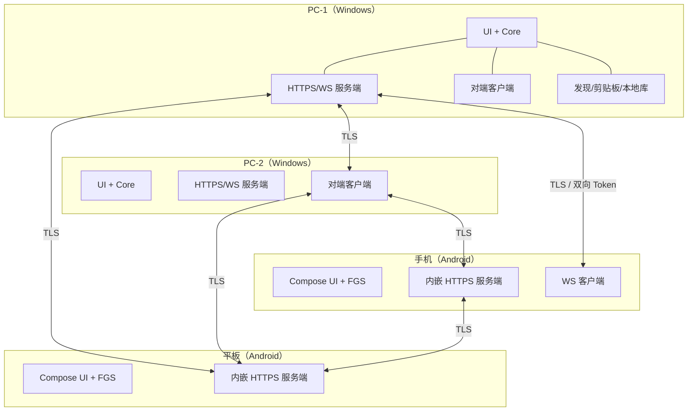
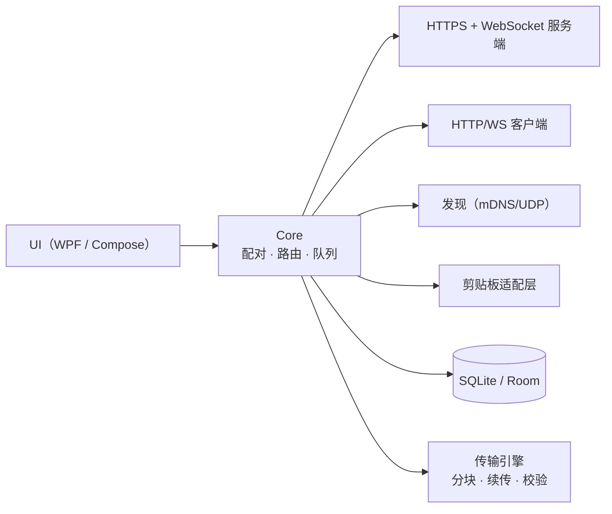
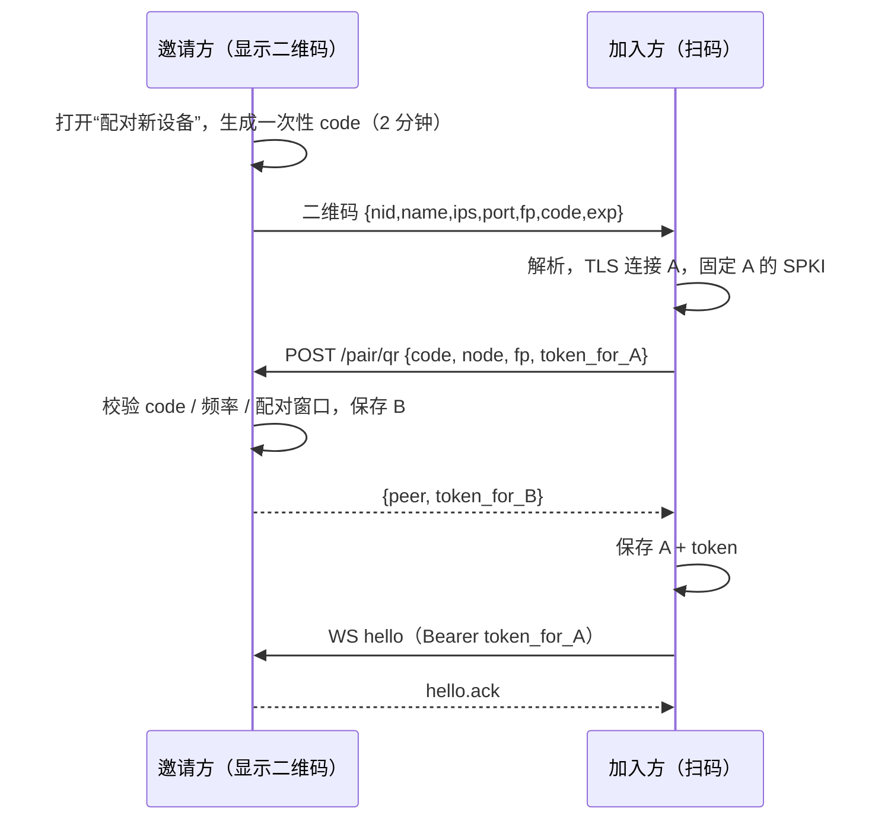
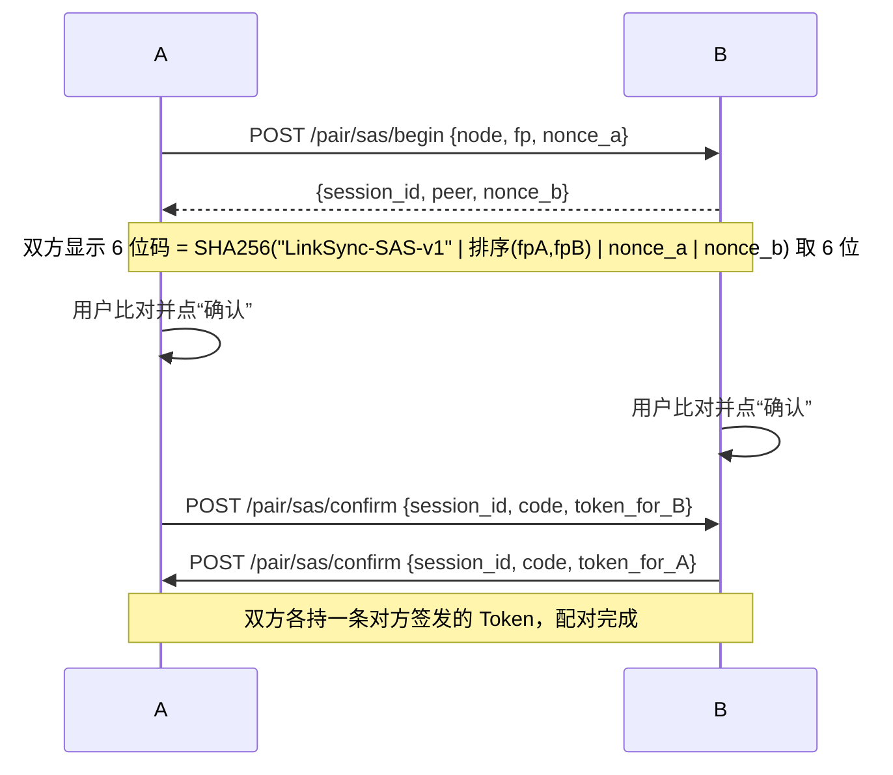
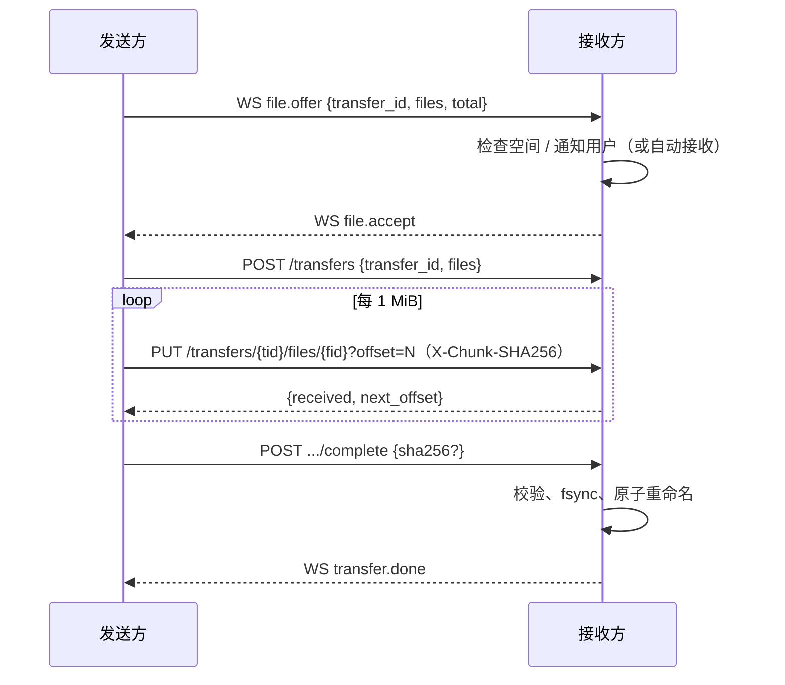

# LinkSync 实现方案 v2（PC / Android 任意互传 · 待评审）

> **修订说明**：v1 把 PC 设计成唯一中枢，只能 PC↔Android，理解错了需求。你要的是 **PC↔PC、PC↔Android、Android↔Android 任意两台设备互传、互相同步**。v2 改为**去中心化 Mesh**：每台设备都是对等节点，任意两台在线即可直连；没有中心、没有云、没有账号。

- 版本：方案 v2 草案（取代方案 v1）；下文功能排期用 **R1 / R1.5 / R2** 表示产品版本，避免与方案版本混淆
- 日期：2026-10-31
- 适用：Windows 10/11 x64；Android 10–16（手机 + 平板）
- 暂定名：LinkSync；包名 `com.linksync.app`

---

## 0. 一页结论

| 项目 | 结论 |
|---|---|
| 拓扑 | N 个对等节点组成 Mesh，两两直连；无中心、无中继 |
| 节点 | Windows 与 Android 跑同一套协议；**每个节点同时是 HTTPS 服务端 + 客户端** |
| 发现 | mDNS（`_linksync._tcp`）+ UDP 广播 + 手动 IP/二维码兜底 |
| 配对 | 手机扫二维码；PC↔PC 用 6 位 SAS 码双端比对；也可手动 IP + 码 |
| 信任 | 每对设备两条单向 Token（各 32 字节）；证书换新需重新配对 |
| 文件 | 发送方**推送**：HTTP PUT 分块（1 MiB）+ 断点续传，可同时发多台 |
| 剪贴板 | 广播给所有“已配对且开启同步”的节点；Android 出站仍受前台/手动限制 |
| 文本 | 可发给单台或多台，对方通知里一键复制 |
| 常驻 | Android：`connectedDevice` 前台服务内嵌 HTTPS 服务器；PC：托盘 + 开机自启 |
| 安全 | 双向 TLS + SPKI 指纹固定 + 每对双向 Token + 仅私有网段 |
| 工作量 | **20–24 个开发日**（比方案 v1 多约 40%，主要是 Android 服务端与 Mesh 连接管理） |
| 最大风险 | Android 后台“可被连接”的可达性（ROM/Doze），以及 N 设备两两配对的操作成本 |

### 与 v1 的差异

| 维度 | v1（错误） | v2（本版） |
|---|---|---|
| 拓扑 | PC 中枢，手机是客户端 | 对等 Mesh，无中心 |
| 服务端 | 只有 PC 监听 | **每个节点都监听** |
| 配对 | 手机扫 PC | QR / SAS / 手动，任意两台 |
| 剪贴板 | 只和 PC 同步 | 广播到所有已配对节点 |
| 文件 | PC↔手机 | 任意方向、多目标并发 |
| Android 职责 | 纯客户端 | 客户端 + 服务端（前台服务内） |

---

## 1. 需求拆解与验收口径

| 编号 | 需求 | 优先级 | 验收标准 |
|---|---|---|---|
| F1 | 任意两节点发现与配对 | P0 | PC↔PC、PC↔Android、Android↔Android 都能在 30 秒内完成配对 |
| F2 | 任意方向文件传输 | P0 | 四种组合都能互发；1 GB ≥ 25 MB/s；断点续传 |
| F3 | 剪贴板多向广播 | P0 | A 复制后，所有开启同步的在线节点 1 秒内更新（Android 作接收方）；Android 作发送方时前台自动、后台一键 |
| F4 | 发送文本供对方复制 | P0 | 可选单台/多台；对方通知点“复制”即入剪贴板；保留历史 |
| F5 | 多设备在线与并发 | P0 | 4 台设备同时在线；两台同时给第三台发文件不串扰 |
| F6 | Android 后台可被连接 | P0 | 息屏 24 h 后，其他设备仍能向其发文件/文本 |
| F7 | 进度、历史、取消、离线队列 | P1 | 目标离线时任务排队，上线后自动补发 |
| F8 | 安全与吊销 | P0 | 未配对设备无法读写；移除设备后立即失效 |
| F9 | 一键邀请入组（自动完成两两配对） | P2 | R1.5；设备 ≥4 台时强烈建议 |
| F10 | 文件夹传输 | P2 | R1.5 |
| F11 | 图片/富文本剪贴板 | P2 | R2 |

**R1 明确不做**：公网/跨网络、iOS/macOS/Linux、云历史、账号体系、中继服务器、商店上架、自动更新（R1.5）、设备组密钥（R1.5）。

**一个必须说清的产品事实**：Mesh 的信任是**两两**的。你有 4 台设备（PC1、PC2、手机、平板），想让它们全部互通，需要配 6 对。R1 用二维码/SAS 让每次配对约 10 秒；如果设备更多，建议把 F9「一键邀请」提前到 R1。

---

## 2. 关键约束（决定架构的六条）

### 2.1 每台设备都必须能被连接

任意互传意味着 **Android 也要跑 HTTPS 服务端**，而不只是客户端。于是：

- Android 必须常驻一个前台服务，服务里同时维持：Ktor HTTPS 服务器、到每个对端的 WebSocket、传输任务。
- 手机换 Wi-Fi / 切网后，监听端口不变，但 IP 变了；对端靠 mDNS/UDP 重新发现，或由手机主动重连并上报新地址。
- 手机被省电策略冻结时，入站连接会失败——发送方必须能排队重试，不能假设“对方一定在线”。

### 2.2 Android 10+ 禁止后台读剪贴板

系统只允许**默认输入法**或**拥有输入焦点的应用**读取剪贴板。因此：

- 任意节点 → Android：**写入**一般可行（部分 ROM 会拦），可自动。
- Android → 任意节点：后台读不到。只能前台自动，或用户一键触发（通知按钮/磁贴/分享/选中文本）。
- 这是系统限制，不是实现问题；产品文案必须提前说明。参考 [剪贴板文档](https://developer.android.com/develop/ui/views/touch-and-input/copy-paste)、[Android 10 变更](https://developer.android.com/about/versions/10/privacy/changes#clipboard-data)。

### 2.3 前台服务类型与 Android 15 超时

- Android 14+ 必须声明 FGS 类型与权限。
- Android 15 起 `dataSync` 类型每 24 小时最多 6 小时；**常驻服务绝不能声明 `dataSync`**。
- 用 `connectedDevice`（与外部设备进行网络交互），无 6 小时限制，且不在 Android 15 的 `BOOT_COMPLETED` 启动限制名单内。参考 [FGS 类型](https://developer.android.com/develop/background-work/services/fgs/service-types)、[FGS 超时](https://developer.android.com/develop/background-work/services/fgs/timeout)。

### 2.4 国产 ROM 无 GMS

- 不能用 FCM 唤醒、不能用 ML Kit 扫码。
- 扫码用 ZXing（离线）；相机用 CameraX。
- 保活必须叠加：FGS + 电池白名单 + 厂商自启动 + 心跳 + 看门狗。

### 2.5 N 台设备是 N² 次配对

两两信任模型下，4 台设备 6 对、5 台 10 对。R1 接受这个成本；R1.5 做“邀请入组”，由已入组设备自动完成新设备与其他成员的两两配对（仍需每台确认一次，但不用手动扫码 N 次）。

### 2.6 只在同一局域网

没有公网中继，也没有 NAT 穿透。跨网络（家里 PC ↔ 公司 PC）R1 不支持。可选的低成本替代：用户自建 Tailscale/WireGuard 组网，本程序仍走局域网地址——这属于部署建议，不写进代码。

---

## 3. 技术选型

### 3.1 本机环境现状（已实测）

| 工具 | 状态 | 说明 |
|---|---|---|
| .NET SDK | ✅ 8.0.133（含 WPF / ASP.NET Core 8.0.33） | 直接开发 PC 端 |
| Node.js | ✅ v20.10.0 | 仅备用 |
| adb | ✅ 33.0.0 | 建议随 SDK 更新 |
| JDK | ❌ | 需装 Temurin 17 |
| Android SDK / Gradle | ❌ | 需装 cmdline-tools + platform 35 + build-tools 35 |
| 磁盘 | ✅ 约 543 GB | 充足 |

### 3.2 选型结论

| 层 | 选择 | 理由 |
|---|---|---|
| PC | .NET 8 + WPF（WPF-UI）+ Kestrel | Windows 集成最好、单文件分发、Kestrel 同时提供 HTTPS/WS |
| Android | Kotlin + Compose + **Ktor Server (CIO)** + OkHttp + JmDNS + Room | Android 必须当服务端；Ktor 提供 TLS/WS/流式上传；OkHttp 做客户端与 SPKI 固定 |
| 证书 | 每节点自签 ECDSA P-256；客户端按 SPKI SHA-256 固定 | 无需 CA；二维码/配对时带指纹 |
| 序列化 | JSON + kotlinx.serialization / System.Text.Json | 双端可读、调试方便 |
| 发现 | mDNS + UDP 广播 | 跨平台标准；Android 需 MulticastLock |
| 扫码 | CameraX + ZXing core | 无 GMS 依赖 |
| 数据库 | SQLite / Room | 历史、队列、对端信息 |

### 3.3 关键第三方库

| 端 | 库 | 用途 | 许可 |
|---|---|---|---|
| PC | WPF-UI | Fluent 主题 | MIT |
| PC | CommunityToolkit.Mvvm | MVVM | MIT |
| PC | Makaretu.Dns | mDNS | MIT |
| PC | QRCoder | 二维码 | MIT |
| PC | Microsoft.Data.Sqlite | 本地库 | MIT |
| PC | Hardcodet.NotifyIcon.Wpf | 托盘 | CPOL |
| Android | Ktor Server CIO | HTTPS + WS 服务端 | Apache-2.0 |
| Android | OkHttp + okhttp-tls | 客户端、证书生成 | Apache-2.0 |
| Android | JmDNS | mDNS | Apache-2.0 |
| Android | Room / WorkManager | 本地库 / 看门狗 | Apache-2.0 |
| Android | CameraX + ZXing core | 扫码 | Apache-2.0 / MIT |

> `okhttp-tls` 的 `HeldCertificate` 会引入 BouncyCastle（用于生成 X.509），APK 约增加 3–5 MB；Ktor + Compose 后 APK 预计 15–20 MB。可接受。

### 3.4 被否决的方案

| 方案 | 否决原因 |
|---|---|
| v1 的 PC 中枢 | 不满足 PC↔PC、Android↔Android；PC 关机即断 |
| 云端中继 | 引入账号、隐私与运维成本；R1 不需要 |
| Syncthing / LocalSend | 无剪贴板/文本；后台与 UI 不可控 |
| KDE Connect | 同样受剪贴板限制；无法定制任意两两配对与文本历史 |
| PWA | 不能后台监听、不能自动读写剪贴板 |
| 全 Web 技术（Electron/Capacitor） | Android 仍需原生服务；包体与内存更大 |

---

## 4. 总体架构

### 4.1 Mesh 拓扑



每个节点内部结构相同：



### 4.2 连接规则

- 每个节点有一个 **NodeId（ULID，字典序可比较）**。
- **NodeId 较小的一方主动拨号**，较大的一方监听接听；每对节点只保留一条 WebSocket。
- 双方都实现拨号与接听逻辑。较小方连续拨号失败 3 次后，较大方也尝试反向拨号（带去重），避免单侧防火墙导致永远连不上。
- 心跳 25 s；25 s 无 pong 判定假连接并重连。
- 对端 IP 变化：优先用 mDNS/UDP 重新解析；失败则用最近一次成功地址；再失败则标记离线并退避重试。
- 离线期间：文本、剪贴板最新值、文件 offer 进入该对端的 pending 队列；对端上线后按序补发。

### 4.3 端口与发现

| 用途 | 协议 | 端口 |
|---|---|---|
| HTTPS + WebSocket | TCP | 47821（占用时 47822–47840 顺延，实际端口写入 mDNS/二维码） |
| UDP 广播发现 | UDP | 47822 |
| mDNS | UDP 组播 | 5353，服务名 `_linksync._tcp` |

- mDNS TXT：`nid`、`name`、`plat`（win/android）、`ver`、`port`、`fp`（SPKI SHA-256 前 16 位）。
- UDP 广播：每 8 秒向 `255.255.255.255:47822` 发 `{nid,name,plat,port,fp,ver}`，同时监听；比 mDNS 更抗路由器兼容性问题。
- Android 需 `MulticastLock` 才能稳定收组播；部分企业 Wi-Fi 开 AP 隔离 → 回退扫码或手动 IP。
- IPv4 优先；IPv6 在 R1.5 评估。

---

## 5. 通信协议

### 5.1 约定

- Base path `/api/v1`；JSON UTF-8；字段 `snake_case`。
- 协议版本头 `X-LinkSync-Protocol: 2`；不兼容返回 `426`。
- 鉴权：`Authorization: Bearer <token>`；服务端只存 Token 的 SHA-256；恒定时间比较。
- 仅接受 RFC1918 / 链路本地来源；公网地址 403（可配置关闭）。
- ID：ULID；时间戳：Unix 毫秒。

### 5.2 节点身份

首次启动生成：

- ECDSA P-256 密钥对 + 自签 X.509 证书（有效期 10 年，CN = NodeId）。
- `NodeId`、`NodeName`（默认主机名/设备型号，可改）。
- **SPKI SHA-256** 作为节点指纹，用于 TLS 固定、二维码、SAS 码。

私钥保护：PC 用 DPAPI；Android 用随机密码加密 PKCS#12，密码由 Android Keystore 的 AES-GCM 密钥包装。

客户端校验：自签证书不能走系统信任链，需自定义 `X509TrustManager`（或 OkHttp `HandshakeCertificates`）比对 SPKI SHA-256 与配对时保存的值；不匹配立即断开并提示“需重新配对”。

### 5.3 配对方式一：二维码（手机扫，或任意带摄像头的一方扫）



- 二维码是带外信道：指纹 + 一次性码都在码里，天然防局域网中间人。
- 配对窗口默认 2 分钟（只对二维码加入生效）；窗口外 `POST /pair/qr` 一律 403。
- code 单次使用；每 IP 每分钟最多 5 次尝试；连续失败 10 次封禁 5 分钟。

### 5.4 配对方式二：SAS 6 位码（PC↔PC，或无摄像头场景）



- 中间人攻击会形成两段不同证书的 TLS，两端算出的 6 位码不同，用户比对即可发现。
- 会话由被请求方（B）创建并返回 `session_id`，A 本地保存；双方各自把“本方 Token”提交到对方，两个方向都确认后才把 Peer 置为 Active。
- begin 不需要对方预先打开配对页，但被请求方必须在 2 分钟内比对并确认，否则会话失效；同一 IP 每分钟最多发起 1 次。
- 若只有一方确认，另一方保持 pending，24 小时后清理；期间不建立 WS。

> 为什么这一版不用“设备组 + 组密钥”：组密钥的加入、轮换、离线成员补发、吊销传播都更复杂，且一旦泄露影响全组。两两 Token 模型简单、可独立吊销；代价是 N 台设备要配 N(N-1)/2 次。等你确认设备数量后再决定是否把“一键邀请”提前。

### 5.5 信任模型：每对设备两条 Token

配对时双方各签发一条 Token：

| 方向 | 谁签发 | 谁保存明文 | 谁保存哈希 |
|---|---|---|---|
| A → B 的请求 | B | A（DPAPI/Keystore 加密） | B |
| B → A 的请求 | A | B | A |

- Token 为 32 字节随机数（Base64Url）。
- 服务端按 `SHA-256(token)` 查对端；对端被移除则立刻 401。
- 证书变化（重装、恢复出厂）→ 固定校验失败 → 标记“需重新配对”，不自动信任新证书。

### 5.6 REST 端点（每个节点都实现同一套）

| 方法 | 路径 | 说明 | 鉴权 |
|---|---|---|---|
| GET | `/info` | 节点名称、平台、协议版本、能力位 | 否 |
| POST | `/pair/qr` | 扫码加入 | 一次性 code |
| POST | `/pair/sas/begin` | 发起 SAS 配对 | 否（限流 1 次/分钟/IP） |
| POST | `/pair/sas/confirm` | 确认 SAS，提交本方 Token | 会话内 |
| POST | `/pair/abort` | 取消配对 | 会话内 |
| POST | `/transfers` | 创建接收会话（发送方调用） | 是 |
| PUT | `/transfers/{tid}/files/{fid}?offset=N` | 上传分块 | 是 |
| POST | `/transfers/{tid}/files/{fid}/complete` | 完成单文件校验 | 是 |
| GET | `/transfers/{tid}` | 查询已收字节（续传用） | 是 |
| DELETE | `/transfers/{tid}` | 取消并清理 `.part` | 是 |
| GET | `/health` | 存活探测（不含敏感信息） | 否 |

### 5.7 WebSocket 消息

端点 `/ws`。统一信封：

```json
{"v":2,"id":"01J9Z6...","type":"clipboard.push","ts":1790000000123,"payload":{}}
```

| 方向 | type | 说明 |
|---|---|---|
| 双向 | `hello` / `hello.ack` | 上线、交换能力位、补发待办 |
| 双向 | `ping` / `pong` | 心跳（25 s） |
| 双向 | `clipboard.push` | `{text, hash, origin, sensitive}` |
| 双向 | `clipboard.ack` | `{hash, applied, mode:"auto"\|"notification"}` |
| 双向 | `text.message` | `{text, id, from, to?}` |
| 双向 | `file.offer` | `{transfer_id, files:[{id,name,size,mtime}], total}` |
| 双向 | `file.accept` / `file.reject` | 接收方答复 |
| 双向 | `transfer.progress` | `{transfer_id, file_id, received, total, bps}` |
| 双向 | `transfer.done` / `transfer.error` | 完成/失败 |
| 双向 | `peer.removed` | 解除配对通知（随后断开） |
| 双向 | `presence` | 电量、网络类型（可选） |

> 广播型消息（`clipboard.push`）**不转发**：只由源节点直接发给每个对端，接收方应用后不得再次广播。

### 5.8 文件传输（发送方推送）



- 分块 1 MiB；逐块 SHA-256；坏块重传 ≤3 次。
- 断点：接收方写 `<name>.linksync-part`；重连后发送方 `GET /transfers/{tid}` 取 offset。
- 落盘：完成后原子重命名；Android 用 `MediaStore` 的 `IS_PENDING`。
- 多目标：发送方为每个目标建独立 transfer，可并发 2–3 个目标；同一目标内文件串行、文件间并发 2–3。
- 自动接收：对“已配对且信任”的节点可开启自动接收（不弹确认），否则每次弹通知由用户确认。
- 校验：默认分块 + 字节数；可选“严格模式”整文件 SHA-256（续传场景需重算）。
- 文件名清洗：去路径分隔符、`..`、Windows 保留名、结尾空格/点；单段 ≤200 字符；重名加 ` (1)`。
- 大文件：全程流式，内存 ≤4 MB；偏移用 `long`。
- 空间不足：接收方 507，并拒绝该文件，不影响同批其他文件。

### 5.9 错误码

`4001` 配对码错误/过期 · `4003` Token 无效 · `4009` 已解除配对 · `4013` 文件名非法 · `4021` 空间不足 · `4022` 校验失败 · `4029` 传输不存在 · `4290` 频率限制 · `5001` 内部错误。

---

## 6. 剪贴板与文本同步

### 6.1 广播语义

- 源节点复制文本 → 立即向**所有**“已配对 + 在线 + 开启接收剪贴板”的节点发送 `clipboard.push`。
- 接收节点写入本机剪贴板，并在 10 秒内抑制相同 hash 的回传；**不做二次广播**。
- 4 台设备时每次复制最多 3 条消息，开销可忽略。
- 若两台几乎同时复制：各自广播，接收方按到达顺序 last-write-wins；R1 不做向量时钟。
- 离线补投的剪贴板只保留最新一条；应用前若本机剪贴板在离线期间已变化，则丢弃该条，避免用旧内容覆盖新内容。

### 6.2 能力矩阵

| 场景 | 任意节点 → Android | Android → 任意节点 |
|---|---|---|
| App 前台、屏幕亮 | ✅ 自动（<1 s） | ✅ 自动（监听 + 800 ms 轮询） |
| App 后台、屏幕亮 | ✅ 自动写入；失败降级通知 | ❌ 系统禁止读取 → 一键触发 |
| 锁屏 | ✅ 写入（部分 ROM 拦截，降级通知） | ❌ 一键触发（需解锁） |
| 服务未启动 | ⏳ 排队，连上补投 | ⏳ 排队 |

Windows↔Windows：双向全自动。

### 6.3 Android 出站的一键入口

1. 常驻通知按钮“发送剪贴板到…”（`PendingIntent.getActivity`）。
2. 快捷设置磁贴（Android 14+ 用 `startActivityAndCollapse(PendingIntent)`）。
3. 系统分享 / 选中文本菜单（`ACTION_SEND`、`ACTION_PROCESS_TEXT`）。
4. App 内按钮。
5. 悬浮球（R2）。

> 通知与磁贴都不能直接读剪贴板（无焦点）。做法：启动透明、无动画、立即 finish 的 `ClipboardBridgeActivity`，取得焦点读取后交给前台服务发送。
>
> 坑：① Android 12+ 禁止“通知→广播→再启 Activity”的 trampoline，“发送剪贴板”必须直接 `PendingIntent.getActivity`；② Android 14+ 对 TileService 启 Activity 有限制，磁贴走 PendingIntent 重载，失败则 Toast 引导。磁贴不是唯一入口。

### 6.4 PC 侧

- 隐藏消息窗口 + `AddClipboardFormatListener`，处理 `WM_CLIPBOARDUPDATE`。
- R1 只处理 `CF_UNICODETEXT`；`CF_HDROP`、`CF_DIB` 在 R2。
- 读取失败重试 5 次；去抖 150 ms；单条上限 100 KB。
- 回环抑制：`last_applied_hash + 时间戳`（10 s）+ `origin` 字段。
- 敏感内容：检测 `ExcludeClipboardContentFromMonitorProcessing`、`CanIncludeInClipboardHistory=0`，命中则不同步、不入历史。
- 仅推给“在线 + 开启自动同步”的对端。

### 6.5 Android 侧

- 写入：`setPrimaryClip`；Android 13+ 会显示“已复制”浮层（含应用名），无法屏蔽，需在引导页说明。
- 前台读取：`OnPrimaryClipChangedListener` + 800 ms 轮询；检查 `EXTRA_IS_SENSITIVE`（API 33+）。
- 文本通知：每条一条，Action“复制” → `BroadcastReceiver` 直接写剪贴板；用户点击即前台交互，稳定可行。
- 历史：Room 最近 200 条 / 7 天；可关闭记录。

### 6.6 发送文本

- 与剪贴板共用通道，但语义分开：剪贴板静默自动；发送文本是显式动作，带通知与历史。
- 目标可选单台或多台；多台时逐个发送并显示送达状态。
- 对方离线 → 进入 pending 队列，上线补投。

---

## 7. 文件传输设计

### 7.1 落点

| 平台 | 默认落点 | 可配置 |
|---|---|---|
| Windows | `%USERPROFILE%\Downloads\LinkSync\<发送方设备名>\<yyyy-MM-dd>\` | 任意目录 |
| Android | `Download/LinkSync/`（MediaStore） | SAF 目录 |

### 7.2 Android 存储

- 接收：MediaStore Downloads，`RELATIVE_PATH=Download/LinkSync`，`IS_PENDING=1` 写完再发布；同名加序号。
- SAF 目录：`takePersistableUriPermission` 持久化；随机写用 `openFileDescriptor("rw")` + `FileChannel.position`；若 provider 不支持 seek，则先写应用缓存再整体拷贝（需要 2 倍空间，UI 提示）。
- 发送：`ACTION_OPEN_DOCUMENT` 多选；`ContentResolver` 流式读；大小取 `OpenableColumns.SIZE`，缺失则事后校正。
- 权限：API 29+ 基本不需要存储权限；SAF 用持久化 URI 授权。

### 7.3 队列与并发

- 发送队列按“目标设备”分组；目标离线则等待重连，不阻塞其他目标。
- 手机端 outbox 入 Room；PC 端入 SQLite。
- 传输中持有 `PARTIAL_WAKE_LOCK` + `WifiLock(HIGH_PERF)`（仅传输期间）；PC 用 `SetThreadExecutionState` 防睡眠。
- “仅 Wi-Fi 传输”默认开；限速可选。

### 7.4 多目标与冲突

- 同一文件发多台：各自独立 transfer，互不影响。
- 同名文件：接收方自动加序号，不覆盖；可在设置改为“覆盖/询问”。
- 发送方源文件被移动/删除：标记失败并提示。

---

## 8. Android 后台常驻（含内嵌服务器）

### 8.1 服务设计

单例 `SyncService`：

- `startForeground(id, notification, FOREGROUND_SERVICE_TYPE_CONNECTED_DEVICE)`。
- 内部启动 Ktor HTTPS 服务器（TLS + WS + 文件上传），并维护到每个对端的 WS 客户端。
- `START_STICKY`、`stopWithTask=false`；只有用户“退出”才真正 stop。
- 通知渠道 `sync_status`：`IMPORTANCE_LOW`、静音、`setOngoing(true)`、`CATEGORY_SERVICE`。
- 通知文案：“已连接 3 台设备 · 正在接收 2 个文件（45%）”；Action：发送剪贴板 / 暂停 / 打开。
- 进度更新用同一通知（`setOnlyAlertOnce`）。

### 8.2 Manifest 草案

```xml
<uses-permission android:name="android.permission.INTERNET"/>
<uses-permission android:name="android.permission.ACCESS_NETWORK_STATE"/>
<uses-permission android:name="android.permission.ACCESS_WIFI_STATE"/>
<uses-permission android:name="android.permission.CHANGE_WIFI_MULTICAST_STATE"/>
<uses-permission android:name="android.permission.FOREGROUND_SERVICE"/>
<uses-permission android:name="android.permission.FOREGROUND_SERVICE_CONNECTED_DEVICE"/>
<uses-permission android:name="android.permission.POST_NOTIFICATIONS"/>
<uses-permission android:name="android.permission.RECEIVE_BOOT_COMPLETED"/>
<uses-permission android:name="android.permission.WAKE_LOCK"/>
<uses-permission android:name="android.permission.REQUEST_IGNORE_BATTERY_OPTIMIZATIONS"/>
<uses-permission android:name="android.permission.CAMERA"/>

<service
    android:name=".service.SyncService"
    android:exported="false"
    android:foregroundServiceType="connectedDevice"
    android:stopWithTask="false"/>

<receiver android:name=".service.BootReceiver" android:exported="true">
    <intent-filter>
        <action android:name="android.intent.action.BOOT_COMPLETED"/>
        <action android:name="android.intent.action.MY_PACKAGE_REPLACED"/>
    </intent-filter>
</receiver>
```

其他组件：`ClipboardBridgeActivity`（透明、`noHistory`、`excludeFromRecents`）、`ShareActivity`、`ProcessTextActivity`、`SyncTileService`、`PairQrActivity`。

### 8.3 保活链路

1. 前台服务（最高优先级通知）。
2. WS 心跳 25 s；失败重连。
3. `ConnectivityManager.NetworkCallback`：Wi-Fi/移动网络切换、恢复时立即重连并重新解析地址。
4. 退避：1/2/5/10/30/60 s；成功回 1 s。
5. 屏幕亮起 / 解锁广播：触发一次重连（ROM 常在息屏冻结网络）。
6. WorkManager 看门狗：每 15 分钟检查服务与监听端口，异常则 `startForegroundService`。
7. 开机自启：`BOOT_COMPLETED` → 启动服务（`connectedDevice` 允许）。
8. `onTaskRemoved` 尝试重启；失败交给看门狗。
9. 对端感知：离线 >2 分钟，在设备卡片显示“可能被系统清理”，并给出排查入口。

### 8.4 省电白名单与厂商引导

首次启动进入“保活向导”：

| 项目 | 做法 |
|---|---|
| 通知权限（13+） | 运行时申请 `POST_NOTIFICATIONS` |
| 电池优化白名单 | `ACTION_REQUEST_IGNORE_BATTERY_OPTIMIZATIONS`；被拒则给手动路径 |
| 厂商自启动 | 按 `Build.MANUFACTURER` 跳转；失败展示图文步骤 |
| 后台弹窗/锁屏显示 | 部分 ROM 需单独允许 |
| 自启动管理 | MIUI 自启动、EMUI 手动管理、ColorOS 允许后台、OriginOS 后台高耗电、One UI 不受限制 |

厂商 Intent（try/catch，失败回退说明页）：

- 小米 `com.miui.securitycenter/com.miui.permcenter.autostart.AutoStartManagementActivity`
- 华为 `com.huawei.systemmanager/.startupmgr.ui.StartupNormalAppListActivity`
- OPPO `com.coloros.safecenter/.permission.startup.StartupAppListActivity`
- vivo `com.vivo.permissionmanager/.activity.BgStartUpManagerActivity`
- 三星 `com.samsung.android.lool/.activity/BatteryActivity`

### 8.5 入站可达性专项

这是本方案新增的关键验收项：

- 息屏 1 h 后，从 PC 向手机发文件，必须能建立连接（白名单 + FGS）。
- Doze 下若入站失败，发送方指数退避，重试间隔上限 5 分钟；手机亮屏后立即恢复。
- 监听端口在服务生命周期内保持不变；服务重启后重新绑定同一端口（失败则顺延并广播新端口）。
- `adb shell dumpsys deviceidle force-idle` 下测连通性；`unforce` 后测恢复时间。

### 8.6 实测命令

```bash
adb shell dumpsys deviceidle force-idle
adb shell dumpsys deviceidle unforce
adb shell am kill com.linksync.app
adb shell dumpsys activity services com.linksync.app
adb shell dumpsys deviceidle whitelist
```

> `force-stop` 后任何应用都无法自启，这是系统限制；UI 必须提示“服务已停止，请打开 App”。

---

## 9. PC 端设计

### 9.1 进程与生命周期

- 单实例：命名 Mutex + 命名管道；重复启动把参数（如“发送此文件”）转交已运行实例。
- 托盘常驻；关闭窗口 = 最小化；退出需确认。
- 开机自启：HKCU `Run` 键，`--minimized`（无需管理员）。
- 传输中 `SetThreadExecutionState` 防睡眠。
- 防火墙：检测入站规则（TCP 47821、UDP 47822、UDP 5353）；缺失时提供 UAC 一键修复，否则给手动步骤。
- 端口占用：47821 起顺延到 47840；实际端口写入二维码/发现。

### 9.2 PC↔PC 配对

- 设备页显示“发现的未配对设备”；点击“配对”进入 SAS 对话框。
- 双方显示相同的 6 位码，用户在两台机器上各点“确认”。
- 无摄像头也能完成，不需要输入 IP。

### 9.3 界面

| 页面 | 内容 |
|---|---|
| 设备 | 已配对节点卡片（在线/离线、平台、最近活动）；发送文件/文本；剪贴板开关；解除配对 |
| 传输 | 进行中/历史；进度、速度、取消、重试、打开目录 |
| 剪贴板 | 总开关、历史、再次发送、清空 |
| 设置 | 节点名、端口、收件目录、开机自启、仅局域网、严格校验、限速、历史、主题 |

托盘菜单：打开 / 发送剪贴板到… / 最近传输 / 暂停同步 / 退出。
视觉：WPF-UI Fluent，浅/深色跟随系统。

### 9.4 打包

- `dotnet publish -c Release -r win-x64 --self-contained -p:PublishSingleFile=true -p:EnableCompressionInSingleFile=true`（约 80–120 MB）。
- 备选框架依赖版（约 2 MB）+ 运行时引导。
- Inno Setup 安装包可选；同时提供便携 ZIP。
- 未签名会触发 SmartScreen，内测可接受。

---

## 10. 数据模型（草案）

```sql
-- 每个节点本地一份（PC: SQLite；Android: Room）
Peer(Id TEXT PK, Name, Platform, Model, CertFpSpki, LastAddr, LastPort,
     LastSeenAt, AutoClipboardSend INT, AutoClipboardRecv INT,
     AutoAcceptFiles INT, CreatedAt, Status)

PeerToken(PeerId, Direction TEXT, SecretOrHash TEXT, CreatedAt)
-- Direction=outbound：本节点出示给对方；存明文（DPAPI/Keystore 加密）
-- Direction=inbound ：对方出示给本节点；只存 SHA-256

Transfer(Id TEXT PK, PeerId, Direction, Status, TotalBytes, CreatedAt, CompletedAt, Error)
TransferFile(Id TEXT PK, TransferId, Name, RelPath, Size, Sha256, ReceivedBytes, LocalPath, Status)
ClipEntry(Id TEXT PK, PeerId, Direction, Text, Hash, Sensitive, CreatedAt)
Message(Id TEXT PK, PeerId, Direction, Text, Status, CreatedAt)
PendingItem(Id TEXT PK, PeerId, Kind, Payload, CreatedAt, RetryCount)
Setting(Key TEXT PK, Value TEXT)
```

---

## 11. 目标仓库结构

```
同步程序开发/
├─ docs/                         # 方案、协议、测试记录
├─ protocol/
│  ├─ openapi.yaml
│  ├─ ws-schema.json
│  └─ test-vectors/
├─ pc/
│  ├─ LinkSync.sln
│  ├─ src/LinkSync.Core/         # 协议、证书、发现、分块、哈希
│  ├─ src/LinkSync.Server/       # Kestrel、REST、WS、鉴权
│  ├─ src/LinkSync.App/          # WPF、托盘、剪贴板、自启
│  └─ tests/LinkSync.Tests/
├─ android/
│  ├─ settings.gradle.kts
│  ├─ app/src/main/java/com/linksync/app/
│  │  ├─ ui/
│  │  ├─ service/                # SyncService、BootReceiver、Tile
│  │  ├─ server/                 # Ktor、TLS、上传、WS
│  │  ├─ net/                    # OkHttp、发现、配对
│  │  ├─ data/                   # Room、Keystore
│  │  └─ transfer/
│  └─ app/src/test/
└─ scripts/                      # 环境、构建、安装、日志
```

---

## 12. 里程碑

| 阶段 | 内容 | 产出 | 预估 |
|---|---|---|---|
| M0 | 环境：JDK 17、Android SDK、镜像、两个空壳跑通 | 可编译 | 1 d |
| M1 | 协议核心 + PC 节点：证书、发现、SAS 配对、WS、文本 | PC↔PC 可配对、可发文本 | 3 d |
| M2 | Android 节点：FGS + Ktor 服务端、扫码、配对 | PC↔Android、Android↔Android 可配对 | 4 d |
| M3 | 剪贴板广播 + 文本历史 + 多目标 | F3/F4 可用 | 2 d |
| M4 | 文件任意方向：offer/accept、分块、续传、多目标 | F2/F5/F7 可用 | 5 d |
| M5 | 后台加固：白名单向导、看门狗、Doze/ROM 实测、入站可达性 | F6 达标 | 3 d |
| M6 | 打包与打磨：安装包、引导、错误提示、双语 | 可交付 | 2 d |

合计 20 d 左右，含缓冲 20–24 d。关键路径：M1 → M2 → M4 → M5。

> 若设备 ≥4 台，建议把 F9「一键邀请」插入 M3 与 M4 之间（+3 d），否则 6 次配对会显著影响体验。

---

## 13. 测试计划

**协议/单元**：分块边界、续传、坏块重传、文件名清洗、路径穿越、Token 校验、SPKI 不匹配、SAS 码计算、消息幂等。

**组合矩阵**：PC1↔PC2、PC↔手机、PC↔平板、手机↔平板（四类组合全部覆盖）。

**多节点**：4 台同时在线；A 复制 → B/C/D 全更新；两台同时给第三台发文件；一台离线后补投；一台重启后重连。

**后台**：息屏 1 h / 8 h / 24 h 入站可达；Doze；重启；强杀；Wi-Fi 切换；飞行模式恢复。

**异常**：断网、切网、存储满、PC 休眠、防火墙拦截、时间不同步、中文/emoji/超长文件名、同名文件。

**性能**：1 GB / 8 GB；1000 个小文件；多目标并发时 Wi-Fi 饱和情况。

**安全**：错误配对码、伪造证书、Token 重放、已移除设备、目录穿越、超大 Content-Length、慢速攻击。

**体验**：配对 ≤30 s；PC 复制到手机 ≤1 s；1 GB ≥25 MB/s；错误提示可自行解决。

---

## 14. 风险登记

| 风险 | 概率 | 影响 | 应对 |
|---|---|---|---|
| Android 后台入站不可达 | 高 | 高 | FGS + 白名单向导 + 发送方重试 + 亮屏恢复；PC 端明确显示“离线/重试中” |
| 国产 ROM 清理服务 | 高 | 高 | 多层保活；PC 端离线告警；接受边界 |
| N 台设备两两配对繁琐 | 高 | 中 | R1 用 QR/SAS 把单次配对压到 10 s；≥4 台提前做“一键邀请” |
| Mesh 连接状态复杂（重复连接/半开） | 中 | 中 | NodeId 决定拨号方；心跳；连接去重；状态机测试 |
| Android 服务端耗电 | 中 | 中 | 心跳 25 s；无传输不持 WakeLock；提供“仅充电时保持”选项 |
| 手机后台读剪贴板限制 | 确定 | 中 | 前台自动 + 一键触发；文案说明 |
| 企业 Wi-Fi AP 隔离 | 中 | 高 | 扫码直连 IP；手机热点备选 |
| Windows 防火墙拦截入站 | 中 | 中 | 一键修复 + 手动指引 |
| 证书变化导致连接失败 | 中 | 低 | 明确提示“需重新配对”，不静默信任 |
| 剪贴板回环 | 中 | 中 | hash + origin + 10 s 抑制 + 接收不转发 |
| 大文件/续传缺陷 | 中 | 高 | 专项测试；分块校验；严格模式 |
| 范围蔓延 | 高 | 中 | R1 冻结功能，按里程碑交付 |

---

## 15. 安全与隐私

### 15.1 威胁模型

| 威胁 | 对策 |
|---|---|
| 局域网窃听 | TLS 1.2+（优先 1.3），仅强套件 |
| 中间人 / 伪造节点 | 配对时固定 SPKI；QR 带外指纹；SAS 双端比对 |
| 未授权接入 | 配对窗口 2 分钟 + 一次性码 + 频率限制 + 每对 Token |
| Token 泄露 | 服务端只存哈希；客户端用 DPAPI/Keystore 加密；可解除配对 |
| 手机丢失 | 在每台对端上移除该设备（逐个移除，R1 无全局吊销） |
| 路径穿越 | 白名单目录 + 文件名清洗 + 规范化校验 |
| 资源耗尽 | 连接数/请求体上限、超时、限速 |
| 剪贴板敏感信息 | Windows 敏感格式过滤 + Android `EXTRA_IS_SENSITIVE`；历史可关 |
| 重放 | 消息 id + 时间窗口 + TLS |

### 15.2 措施

- 自签 ECDSA P-256；私钥 DPAPI / Keystore 包装；证书 10 年。
- 客户端按 SPKI SHA-256 固定，主机名校验关闭（以固定替代）。
- Token 32 字节随机；恒定时间比较；每对双向独立。
- 仅私有网段；默认不响应公网来源。
- 日志不打印 Token、配对码、剪贴板正文。
- 无遥测、无账号、无云；卸载清除本地数据。

### 15.3 残余风险

- 解除配对是**逐节点**的：你在 A 上移除 B，C 仍可能信任 B，直到 C 也移除。R1.5 做“广播吊销 + 确认”。
- 已 root 的手机、被入侵的 PC 无法防御。
- Windows 剪贴板对本机所有进程可见，是系统特性。
- 公共 Wi-Fi 下即使有 TLS，也建议关闭自动同步。

---

## 16. 待你确认的决策点

1. **设备规模**：一共几台（如 2 PC + 手机 + 平板 = 4 台）？≥4 台建议把“一键邀请入组”提前到 R1。
2. **网络范围**：只做同一局域网（推荐 R1）/ 必须跨网络（需中继或依赖 Tailscale 类组网，架构要再改）。
3. **PC↔PC 配对**：SAS 6 位码双端比对（推荐，无需摄像头）/ 手动输入 IP + 码。
4. **剪贴板回传**：接受 Android 后台需一键触发（推荐）/ 必须全自动（只能做输入法，另议）。
5. **R1 是否含文件夹传输**：建议不含，R1.5 加。
6. **默认目录**：PC `Downloads\LinkSync`、手机 `Download/LinkSync` 是否可以。
7. **安装形态**：便携 ZIP / 安装包 / 开机自启默认开。
8. **界面语言**：仅中文 / 中英双语。

---

## 附录 A：二维码内容

```json
{
  "v": 2,
  "t": "pair",
  "nid": "01J9Z6K3M4",
  "name": "DESKTOP-8K2L",
  "plat": "win",
  "ips": ["192.168.1.20"],
  "port": 47821,
  "fp": "sha256/AbCd...",
  "code": "482913",
  "exp": 1790000120000
}
```

## 附录 B：SAS 码计算

```
code = decimal6( SHA256( "LinkSync-SAS-v1" || sorted(fpA, fpB) || nonceA || nonceB ) )
```

- `fp` 为 SPKI SHA-256 的 Base64Url。
- 两端各自计算；显示为 6 位数字（前补零）。

## 附录 C：协议片段

**上传分块**

```http
PUT /api/v1/transfers/01J9.../files/01JA...?offset=1048576 HTTP/1.1
Authorization: Bearer <token>
Content-Type: application/octet-stream
X-Chunk-SHA256: 3f79...

<1 MiB binary>
```

```json
{"received": 2097152, "next_offset": 2097152}
```

**文件 offer**

```json
{
  "v": 2,
  "type": "file.offer",
  "ts": 1790000000123,
  "payload": {
    "transfer_id": "01J9...",
    "total_bytes": 734003200,
    "files": [
      {"id": "01JA...", "name": "报告.pdf", "size": 734003200, "mtime": 1789990000000}
    ]
  }
}
```

## 附录 D：主要依据

- [Android 剪贴板](https://developer.android.com/develop/ui/views/touch-and-input/copy-paste)
- [Android 10 剪贴板变更](https://developer.android.com/about/versions/10/privacy/changes#clipboard-data)
- [前台服务类型](https://developer.android.com/develop/background-work/services/fgs/service-types)
- [前台服务超时（Android 15）](https://developer.android.com/develop/background-work/services/fgs/timeout)
- [Doze 与应用待机](https://developer.android.com/training/monitoring-device-state/doze-standby)
